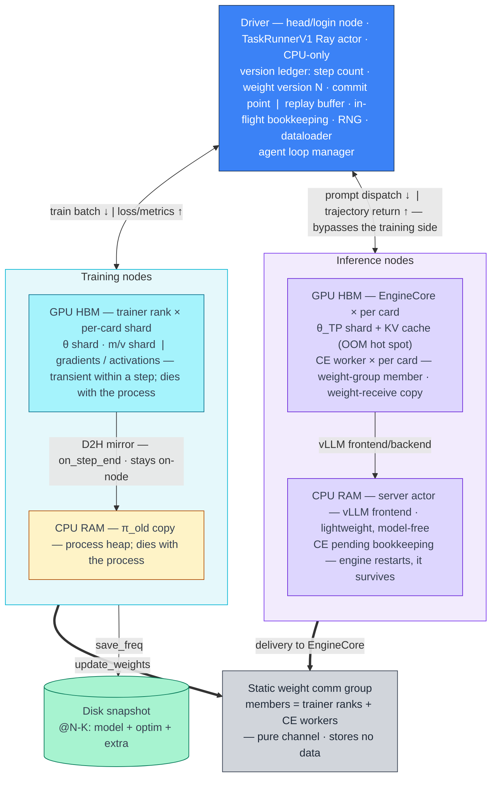
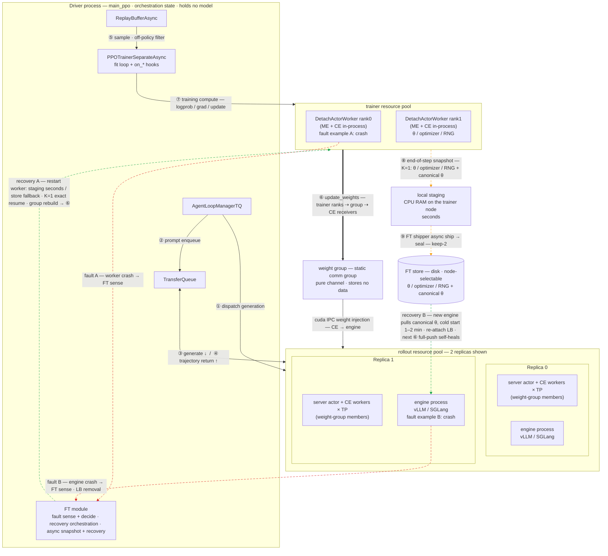
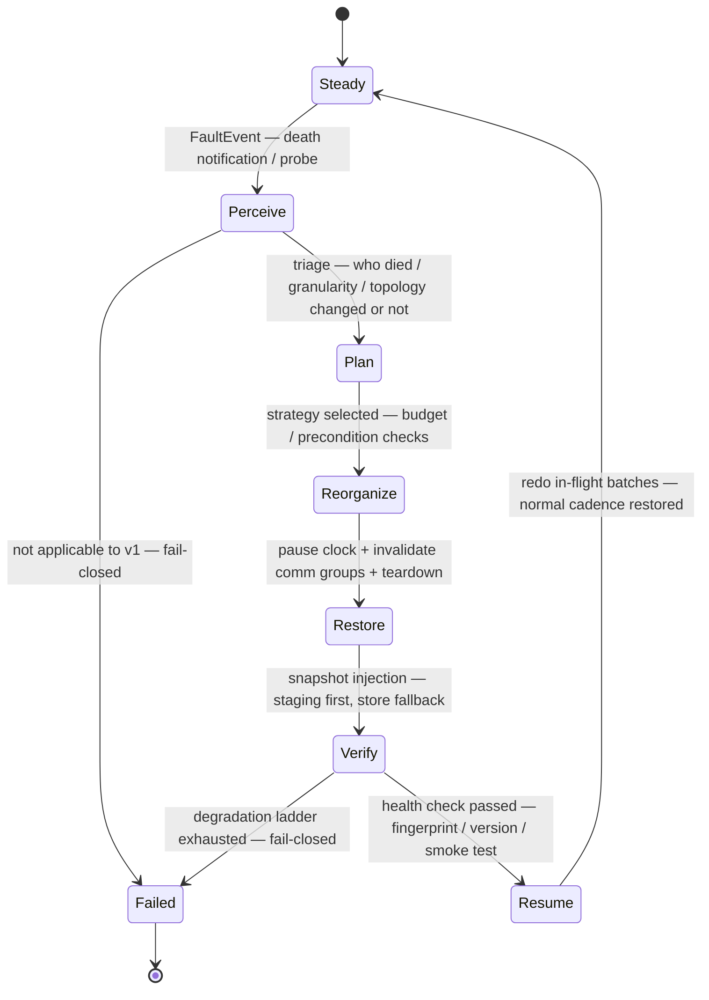

# verl Fault Tolerance (FT) — Design Specification

> **Status — draft for discussion.** Detailed design of the separate_async fault-tolerance proposal, **v2 recovery-source scheme**: per-step engine-native snapshot → local staging → aggregated FT store; the trainer side and the rollout side each self-recover from the store, independently and without disturbing each other. This scheme supersedes the "mutual HA / reverse weight pull" design in the original RFC body; the tracking issue will be refreshed separately once this draft settles. The runtime view in §4 is rendered as a Mermaid diagram; a polished standalone figure may be added later.

## 1. Background & Goals

### 1.1 The problem

Long-run stability is a key pain point of RL training jobs:

- **#6583**: a 256×H200 production run died after 6 hours when a single vLLM EngineCore process died — the whole job was lost;
- verl's only exit path for process-level faults = **crash the whole job + restart from an on-disk checkpoint** (5–10 minutes, K steps of progress lost) — no relauncher, no max_restarts (#1314, in the maintainer's words: "Currently it just throw the exception and fails, relying on checkpoints to resume training");
- Faults are not rare, and most are soft: an Llama 3 production run saw 466 interruptions in 54 days; ByteRobust's three-month study found **22.7% of faults recover with a plain hardware restart** — soft faults such as OOM and process crashes dominate, and their recovery cost should be low;
- **#8186 (26Q4 roadmap)** already set two goals: "Trainer restart without interrupting rollout" and "Rollout replica restart without interrupting trainer".

### 1.2 Structural advantages of separate_async

The proposal rests on three structural advantages of post-training (RL) over pretraining:

| Advantage | Pretraining's constraint | separate_async's free replacement |
|---|---|---|
| Soft RL state | Training data is non-regenerable; once lost, it must be re-collected | Rollouts can be regenerated, batches redone, off-policy tolerated → **progress may be lost, correctness is not** |
| Slow, long steps | Second-scale continuous steps make snapshots expensive | Measured ~30-min steps for a 35B run → **per-step snapshot (K=1) at near-zero cost** (mean bandwidth 272 MB/s) |
| Existing dual-engine plumbing | Weight-format conversion / sharded saves are built per stack | `per_tensor_param` enumeration + engine-native save = ready-made contracts at both ends of the snapshot pipeline |

Moreover, the two sides' fault domains are naturally independent (async decoupling): when one side fails, the other keeps working — "mutual non-interruption" is a constructive result, not luck.

### 1.3 Goals

| # | Capability | Acceptance test |
|---|---|---|
| **G1** | Trainer-side independent restart: OOM / process crash / transient hang → same-node recovery in ≤ x min, rollout uninterrupted throughout, version continuity, in-flight batches redone with zero loss | kill -9 / CUDA OOM injection |
| **G2** | Rollout-side independent restart: engine fault → replace + canonical cold start (~2-min scale), trainer not restarted, zero cooperation required | EngineCore SIGKILL injection |

Three further design goals run throughout:
**G3 universal extensibility** (GPU/NPU × NCCL/HCCL × FSDP/Megatron × vLLM/SGLang — one framework + registrable instances)
**G4 low overhead** (near-zero steady-state impact; zero FT GPU-memory footprint)
**G5 unattended operation** (detect → recover fully automatically; automatic degradation on uncertainty).

---

## 2. Failure scenarios & scope of this phase

### 2.1 Failure classes (ordered by detection difficulty)

| # | Class | Topology | Detection outlet | Disposition path | Design depth |
|---|---|---|---|---|---|
| F1 | OOM (memory-side, hardware intact) | unchanged | immediate error — fails loudly, seconds | in-place revival | **core of this phase** |
| F2 | process crash / transient comm hang | unchanged | Ray death notification within seconds; hangs converted to death notifications by probes / bounded timeouts | same as above | **core of this phase** |
| F3 | single-GPU fault (GPU/HBM/NVLink) | changed (card-level) | ECC / health check / driver errors | scale-down re-sharding / pause for repair | skeleton |
| F4 | whole-node death / reboot (incl. rack-level) | changed (node-level and above) | Ray node death notification (GCS) | remote re-assembly (store tier) | skeleton |
| F5 | slow / gray failures (alive but degraded) | half-changed | tail latency / heartbeat jitter (no death notification) | detection + alerting → future disposition | skeleton (detection first) |

The full eight failure classes (incl. preemption / partition / SDC) converge onto ~2.5 recovery paths: **in-place revival / remote re-assembly / detection-only** — pluggable detection, convergent recovery paths: this is the foundation that makes a unified FT framework viable.

### 2.2 Scope of this phase

**Precisely: F1/F2 ∧ node alive ∧ physical topology unchanged ∧ software version unchanged** — "fails loudly + same cards, same nodes, same shape + same code, same config":

| # | Scenario | Actions per side |
|---|---|---|
| 1 | Transient OOM (trainer-side allocator; engine-domain OOM = #8168 replacement unit) | trainer full-group in-place restart (§5.2) / engine replace (§5.1) |
| 2 | Process crash (kill -9 / segfault / CUDA error / NCCL transient break) | same as above (validated by V1 / R1 / R6) |
| 3 | Transient comm hang / poisoned group handle (alive but unresponsive) | detection conversion (probe / bounded timeout on first sync → forced kill → death notification) → same as above (R7 validates the fallback chain) |

### 2.3 Out-of-scope scenarios (fail-closed, automatic fallback to current behavior)

1. **Permanent topology deformation** (scale-down to N-1 / node removal / heterogeneous replacement): trainer-side world-size change = shard re-partitioning, Phase 2; rollout-side replica removal is nearly ready — a low-cost Phase-2 candidate;
2. **Software version change**: the FT automatic pipeline's contract = same version (Ray respawn reuses the same runtime_env); cross-version changes go through verl's existing planned disk-checkpoint resume;
3. **Gray failures (F5)**: v1 provides signal bits + alerting only — detection first (Phase 3).

Any uncertain situation **fail-closes** to verl's current behavior (crash + manual checkpoint restart) — **FT is never worse than no FT**. Repeated OOM (flapping) is guarded by a restart-budget circuit breaker: the automatic pipeline does not retry indefinitely.

### 2.4 Disposition tiers

| Tier | Name | Trigger precondition | Automation |
|---|---|---|---|
| P1 | in-place restart (fast path) | same shape · now ∧ same version | fully automatic |
| P2 | snapshot-rollback restart | same ∧ local staging unavailable (node dead) | fully automatic |
| P3 | degraded operation (scale-down / remote re-assembly) | permanent deformation | Phase 2 |
| P4 | cold start (checkpoint resume) | fallback tier = verl's existing capability | manual (fail-closed baseline) |
| P5 | human intervention | hardware repair / incompatible upgrade / topology rearrangement | manual |

---

## 3. State analysis

**Runtime state layout**:



### 3.1 Two-sided independence

| Dimension | When the trainer side faults | When the rollout side faults |
|---|---|---|
| Fault domain | trainer process group | a single engine process |
| The other side | **zero restarts**; engines serving throughout | **zero restarts**; trainer keeps training |
| Production during recovery | rollout keeps generating; the buffer absorbs (bounded clock pause if the watermark is exceeded) | trainer keeps training; the remaining replicas carry inference throughput |
| Recovery source | local staging → FT store | FT store canonical θ |
| Disturbs the other side? | no — no disturbance, no waiting, no liveness dependency | no |

### 3.2 Trainer-side state (11 items)

| # | State item | Steady-state location | Disposition | Recovery source / mechanism |
|---|---|---|---|---|
| 1 | Parameters θ (shards) | trainer GPU | **recover** | (1) local staging @N — same node, seconds; (2) FT store sealed @N(-1) — cross-node, ~7 min @10GbE; rank-aligned read + manifest layout check |
| 2 | Optimizer (m, v, t) | trainer GPU | **recover** | same as θ — same source, same seal; K=1 ⇒ exact resume from @N |
| 3 | Gradients / activations / unfinished forward | trainer GPU | recompute | the driver **redoes** in-flight batches — semantically identical to pre-fault, zero data loss |
| 4 | RNG state | in-process | not lost | deterministically re-derived by the driver from seed + step (+ backup inside extra) |
| 5 | Global step / version ledger / FT generation | driver | not lost | held authoritatively by the driver |
| 6 | Buffer / in-flight batch bookkeeping | driver | not lost | **buffer retained, not flushed** — with K=1 exact resume, data validity is identical to the no-fault case |
| 7 | LR scheduler | in-process | rebuild | loaded from ckpt extra + fast-forwarded to the current step (ms) |
| 8 | π_old CPU copy | process heap | recompute | automatically rebuilt next round (it exists only for π_old stability, not as a recovery source) |
| 9 | CUDA context / comm handles | in-process | rebuild | new-process init + new rendezvous — process-private state, physically non-inheritable |
| 10 | Local staging / FT store snapshots | node NVMe / independent fault domain | not lost | they survive process death; node alive ⇒ staging is present |
| 11 | CE-worker-side state — pending / weight-group handles | rollout side | not lost | pending preserved; old-generation handles replaced by the G+1 rebuild |

### 3.3 Rollout-side state (10 items)

| # | State item | Steady-state location | Disposition | Recovery source / mechanism |
|---|---|---|---|---|
| 1 | Engine parameters θ | EngineCore GPU | **recover** | **cold start from the FT store canonical θ directory** — HF safetensors; TP re-sharding done by the engine itself, 1–2 min; fallback = trainer re-push via the CE worker (#8168 `next_weight_sync`) |
| 2 | KV cache | EngineCore GPU | recompute | re-prefill; async clients continue from the token prefix — already-generated tokens are not re-sampled |
| 3 | In-flight requests / partial trajectories | engine process | replay | client-side bounded replay (regular clients replay the whole turn / async clients continue the prefix) |
| 4 | Sampling randomness state | engine process | rebuild | new engine process — inside the replay path |
| 5 | Pending-request bookkeeping | CE worker | not lost | it survives engine restart (slow path: CE itself dies → bounded-replay fallback) |
| 6 | GPU resource pools / memory quota | held by CE worker | not lost | the new engine takes over the same quota — the basis of "same-pool, seconds-scale" reuse |
| 7 | server_adapter binding | CE worker | rebuild | rebind to the new engine process |
| 8 | Weight-group handles | CE worker | rebuild / skip | provably skippable — see the four-condition predicate in §5.3 — or G+1 rebuild |
| 9 | All state of the other replicas | other replicas | not lost | replicas are isolated; serving continues |
| 10 | All trainer / driver state | training side | not lost | zero awareness (invisible within the buffer watermark; bounded clock pause beyond it) |

---

## 4. Architecture

**FT runtime view**:



> Edge legend: solid = normal operation flows (①-⑦ · IPC); thick = ⑥ weight data flow (`update_weights`: trainer ranks ⇢ group ⇢ CE receivers); **orange dashed = FT steady-state data plane** (⑧ end-of-step snapshot K=1 → local staging; ⑨ FT shipper async ship → seal, keep-2); **red dashed = fault paths** (examples A/B, one of them, never simultaneous); **green dashed = recovery paths** (trainer side reads staging/store shards and injects; rollout side pulls canonical θ from the store via `read` to cold-start a new engine).

### 4.1 Overall design idea

In one sentence: **in steady state, maintain a per-step snapshot at near-zero overhead (⑧→⑨); on fault, run a unified lifecycle in which each side recovers from the snapshot independently, without disturbing the other** — everything added on top of "two-sided independent restart capability" converges into a single FT module.

Three design pillars:

1. **Single snapshot source**: end-of-step engine-native save → local staging → FT shipper async-transfers to the FT store. Two-tier async snapshotting: RAM staging (seconds) → store (minutes).
2. **Independent two-sided self-recovery**: a trainer-side fault reads staging/store shard files; a rollout-side fault cold-starts from the store's canonical θ. Zero overlap of recovery sources; recovery actions never intrude on the other side; a both-side fault recovers fully in parallel.
3. **Unified FT-module orchestration**: failure scenarios are diverse and repair forms differ; one framework fixes the shared lifecycle and orchestration rules, opening registration points for scenario and backend variance. This phase implements two scenario instances; later scenarios evolve in the same framework.

### 4.2 Layered architecture

```
L3 control plane   FTOrchestrator — host = driver, CPU-only
                   ├ membership: multi-source death notifications normalized — Ray death / heartbeat timeout / probe → FaultEvent
                   ├ version ledger: step count / weight version N / commit-point triple / in-flight batch bookkeeping
                   └ orchestration state machine (§4.3): pause clock / backpressure / recovery progression / budget & degradation
L2 strategy layer  scenario → action — RecoveryStrategy, first-class and registrable
                   ├ trainer_inplace_restart — F1/F2, trainer side
                   └ rollout_replace — F1/F2, rollout side
L1 primitive layer snapshot pipeline — staging rotation + shipper / FT store / canonical θ export
                   comm-group rebuild — generation fencing / process surgery — kill / respawn / handle swap
L0 sensing layer   loud failures — Ray death notifications, the detection backbone | slow signals — heartbeat / probe fallback | precursors — signal bits reserved, v1 alerts only
```

### 4.3 FT lifecycle



### 4.4 Design principles

| Principle | Where it lands |
|---|---|
| **fail-closed** | unclassified fault / strategy not applicable / recovery budget exceeded / FT itself faulty → automatically fall back to verl's current behavior |
| **minimal intrusion** | only 5 thin host integration points (§5.4); everything else is contained in `verl/ft/`; trainer kernels — FSDP / Megatron — are **untouched** |
| **engine-blind + thin adapters** | the FT module is unaware of engine types; canonical export is built on the `per_tensor_param` contract — **one implementation for FSDP / Megatron**; adapters only call existing engine public methods |
| **master switch** | with `trainer.ft.enabled=false`, every hook is a no-op with zero behavior change — regression-safe, gradual rollout |

---

## 5. Implementation

### 5.1 Rollout-side independent restart (replace + canonical cold start)

Builds on **#8168** (restart / check_health / client bounded replay); the increments of this proposal = the detection layer + orchestration automation + the weight source switched to snapshot cold start + the SGLang port of the same contract.

```mermaid
sequenceDiagram
    autonumber
    participant D as Driver — FT module
    participant CE as CE worker — preserved
    participant E as Engine process — replaced
    participant S as FT store
    participant T as Trainer ranks
    participant C as Async clients
    Note over E: EngineCore crash — OOM / SIGKILL
    E--xD: engine_failed — passive death notification
    D->>E: active check_health confirmation + debounce
    D->>D: triage — fault domain within the engine domain? otherwise fail-closed
    D->>D: fence — remove the faulty replica from the LB
    D->>CE: restart_replica — swap the engine process; CE and resource pools untouched
    D->>D: weight-group disposition — §5.3: provably skippable if all four conditions hold, else G+1
    alt main path — default
        S-->>E: canonical θ directory cold start — 1-2 min, TP re-sharding done by the engine itself
    else fallback — snapshot unavailable / PR-1 transition
        T->>E: trainer-initiated update_weights(N) at a safe boundary
    end
    D->>E: health check — check_health + parameter fingerprint
    D->>E: re-attach to the LB — hard constraint: must be the last step
    C->>E: bounded replay / token-prefix continuation — restore in-flight requests
    Note over T: never restarted; the clock pauses only if the buffer runs dry
```

**Slow path (CE worker implicated — R6, same-card collateral)**: the CE worker respawns in the same pool (existing mechanism, `replica.py:195-244` — the engine process is untouched) + the weight group is **forced to G+1** (the skip predicate is necessarily false) + pending bookkeeping is lost → client bounded-replay fallback — the only state difference from the fast path. Every increment is bounded: fast path + seconds-scale G+1 + seconds-scale respawn.

### 5.2 Trainer-side independent restart (full-group in-place restart + new weight/optimizer snapshot)

#### 5.2.1 Snapshot data plane (steady state, every step)

```
End-of-step sequence — paired with the commit point; identical shape for both engine families, FSDP and Megatron:
  optimizer.step → update_weights(N) push
  → engine-native save_checkpoint → local staging/snap_N/ — each rank writes its own shard in parallel; seconds; keep-2 rotation
  → canonical θ export — per_tensor_param enumeration → safetensors HF directory; end-of-step synchronous window ~10-30s
FT shipper — async, off the critical path:
  rank0 open_session(N, file manifest, world layout) → each rank put_file in parallel → file set complete → store seal — the single commit point
  → keep-2 rotation → expired/unsealed garbage collection; latest-first, abandon-when-superseded — once snap_{N+1} opens, N's remaining PUTs are dropped
```

- **Snapshot contents**: θ + m/v [+ master] + extra (step count / RNG / lr / version N) + a canonical θ copy; **excludes data.pt / transfer_queue** — their owner lies outside the driver's fault domain and survives by construction.
- **Immunity to half-written snapshots**: an engine save that returns successfully = staging complete; a crash landing mid-save/mid-ship = an incomplete session file set = **never sealed** = recovery automatically falls back to the previous sealed (N-1) — FSDP save's long-standing non-atomicity problem is dissolved this way.
- **FT store (aggregated store, the single unified source for both sides' recovery)**: always guarantees one usable, latest, complete snapshot; pluggable endpoint: `local:/path` (single node / shared FS) or `http://host:port`.

#### 5.2.2 Recovery flow

```mermaid
sequenceDiagram
    autonumber
    participant D as Driver — FT module, CPU-only
    participant T as Trainer ranks
    participant CE as CE worker
    participant E as Rollout replicas
    participant S as FT store
    Note over T: OOM / process crash / hang
    D->>D: detect — Ray death notification, seconds
    D->>D: triage — process-level and topology intact? otherwise fail-closed
    D->>T: pause the clock — training side only; E keeps generating, the buffer absorbs
    D->>T: teardown — kill the full trainer actor group
    D->>CE: bounded teardown of the old weight group — abort + destroy, §5.3
    par rebuild — dominant term of same-node RTO
        D->>T: respawn the full group — recovery mode, skip disk loading
        T->>T: new-generation rendezvous — G+1 → weight-group rebuild
    and snapshot fetch — started in parallel with the rebuild
        T->>T: same node: read local staging @N directly — seconds
        T->>S: cross-node: parallel GET of store sealed @N(-1) — ~7 min @10GbE
    end
    T->>T: inject θ + m/v + extra — manifest check; RNG / step re-derived from the driver ledger
    D->>T: health check — parameter fingerprint + version continuity + comm smoke test
    D->>T: re-enter — redo in-flight batches, resume normal training
    Note over E: never restarted, never interrupted
```

**Degradation ladder (recovery sources fall back in order)**: staging missing / layout mismatch → store sealed (P2) → store unavailable / sealed too old → bounded retries → **fail-closed → P4 manual** (= verl's current behavior). A second fault inside the recovery window: degrade to the bottom in one shot (the store's latest sealed) — no iteration, no oscillation.

### 5.3 Weight comm-group rebuild

Weight-group members = trainer ranks + CE workers (**engines are outside the group**). Three gaps in the current code: a poisoned group cannot be torn down in bounded time (only the ~10-min watchdog — and `TORCH_NCCL_ASYNC_ERROR_HANDLING` at its default kills the process); the group name is the constant `"default"` with no namespace isolation; membership changes do not trigger a rebuild (`add/remove_replicas` only mutates the list). Four changes:

1. **Bounded teardown contract**: watchdog / PG timeout (60–120 s, configurable) → **all-member abort** → destroy; a startup assertion `TORCH_NCCL_ASYNC_ERROR_HANDLING==2` (NCCL semantics: after any rank aborts, survivors must not destroy gracefully).
2. **Generation fencing**: group names carry an increasing generation (`...ft_g{G+1}`) + TCPStore key rotation + a ZMQ out-of-band fence between destroy and re-init (to counter the destroy→re-init race) — old-generation processes are isolated by namespace, and the idempotency mechanism naturally rebuilds.
3. **Manager API**: `swap_actor_group(new_wg)` (handle swap after respawn) + `invalidate_group(gen)` + `add/remove_replicas` honoring the rebuild semantics their docstrings already promise (compatibility for existing fully_async callers explicitly declared in the PR description).
4. **Rebuild path = normal path**: the three-step `build_process_group` protocol is reused as-is; an uninitialized new group name ⇒ natural rebuild; the rebuild hides inside the trainer-respawn wait window, off the critical path.

**Rebuild vs skip**: a spurious rebuild ≈ free (seconds, lazy); a spurious skip = the first post-recovery sync hangs ⇒ **rebuild by default**; provably skippable only when all four conditions hold — fault classification within the engine domain ∧ member process identity unchanged ∧ control plane healthy ∧ sync lock clean.

**NCCL / HCCL differences**: in-place rebuild (shrink/grow) exists only in NCCL 2.27+ and the wrapper rewiring has no public tests — an ecosystem gap — so v1 always takes the universal "full re-rendezvous" fallback (semantically equivalent across NCCL/HCCL; touches no torch internals); HCCL additionally has a stateless mode (`rebuild_group=True`, build-and-tear per sync — an existing engine config) to switch to when teardown behavior does not match expectations.

### 5.4 Host integration points (5, all thin)

Line numbers below refer to the codebase at the time of writing.

| # | Integration point | Current state | Change | Implementation PR |
|---|---|---|---|---|
| 1 | fit loop (`trainer_base.py:467-501`) | the while body has no exception handling; exceptions flip the job over directly | wrap with `fit_supervised`: exception → FaultEvent → pause clock → recover → redo | PR-3 |
| 2 | worker init (`trainer_base.py:854-873`) | resume_mode dispatches to three disk-loading branches | a fourth `ft_recovery` branch: skip disk, meta-init, wait for injection | PR-3 |
| 3 | checkpoint manager (`base.py:380-536`) | actor_wg fixed at construction; add/remove only mutates the list | `swap_actor_group` + `invalidate_group` + teardown/generation (§5.3) | PR-2 |
| 4 | rollout patrol / death notifications (`llm_server.py`) | no active patrol | periodic membership `check_health` + passive death-notification normalization | PR-1 |
| 5 | membership polling (`single_controller/ray/base.py:511`) | `_is_worker_alive` exists but nothing consumes it | periodic polling of trainer actors + CE handles → normalized death notifications | PR-1 / PR-3 |

**Integration point 1 — the fit-loop wrapper** (zero judgment logic inside the loop — "translate, don't handle": verl has several trainer loops, and inlining the judgment = the logic duplicated ×N; the exception a loop sees ≠ the ground truth of the fault, which must be triangulated from multiple sources before triage):

```python
# ft.api.supervisor.fit_supervised — wraps the fit while-body of trainer_base.fit
def fit_supervised(trainer):
    while not trainer.finished():
        try:
            trainer.fit_step()             # on_step_begin → train_step → on_step_end
        except (RayActorError, WorkerError) as e:
            if not ft_enabled(trainer.config):
                raise                       # current behavior: propagate — the whole job crashes
            event = translate(e)            # symptom → FaultEvent (authoritative signal = membership death notification)
            plan = orchestrator.handle(event)  # triage → pause clock → teardown → rebuild → inject → health check
            if plan is FAIL_CLOSED:
                raise                       # preserve verl's current behavior
            trainer.reenter(plan)           # re-enter: step-begin idempotence ("step-begin already executed" mark) + redo of in-flight batches
```

**Integration point 2 — the worker-init fourth branch + the end-of-step snapshot hook**:

```python
# trainer_base.py, at the resume_mode dispatch (:854-873) — new fourth branch
def init_worker(ctx):                            # ctx = RecoveryContext, carried by the respawn
    if ctx.mode == "ft_recovery":
        model = meta_init()                       # skip disk weight loading; build only the model skeleton + FSDP metadata
        shards = load_shards(ctx.snapshot_source, # (1) staging @N — same node; (2) store sealed @N(-1)
                              rank, expected_layout=W)  # rank-aligned read + manifest layout check (explicit error on mismatch)
        rng, lr = driver_ledger.rederive(seed, step)   # deterministic re-derivation from seed + step / lr fast-forward

# end-of-step sequence on on_step_end (hooked into the existing hook system; no-op when ft.enabled=false)
def on_step_end(self):
    self.update_weights(version=N)                        # existing weight sync, unchanged (paired with the commit point)
    self.engine.save_checkpoint(f"staging/snap_{N}/")     # engine-native save → local staging (keep-2 rotation)
    export_canonical(per_tensor_param)                    # → HF safetensors directory (one implementation, both engine families)
    shipper.ship_async(N)                                 # rank0 open_session → each rank put_file → seal when the file set is complete
```

**Integration points 4/5 — rollout-side detection and orchestration**:

```python
# llm_server.py, manager layer — active patrol (passive engine_failed is normalized into the same FaultEvent on another path)
async def ft_watch_loop(manager, interval_s):
    while True:
        for rep in manager.replicas:
            if not rep.check_health():            # #8168 primitive
                ft.report(FaultEvent(class=ENGINE, dead=rep))
        await asyncio.sleep(interval_s)

# ft.strategies.rollout_replace — seven-step inline state machine (code form of the §5.1 sequence)
def on_event(ev):
    if not applicable(ev):          # fault domain outside the engine domain / uncertain → fail-closed
        raise
    lb.remove(ev.dead)             # (3) fence
    ev.dead.restart()              # (4) #8168: swap the engine process; CE worker and resource pools untouched
    load_canonical(store) if cfg.source == "store_canonical" else trainer.repush(N)  # (5) weight source
    verify(ev.dead)                # (6) health check: check_health + parameter fingerprint
    lb.add(ev.dead)                # (7) re-attach to the LB — hard constraint: must be the last step
```

**FSDP / Megatron dual backend: one FT implementation + two thin adapters** — surgery / rebuild / orchestration carry zero backend branching (all of it lands in the single_controller + manager layers); the `ft_recovery` branch goes into the backend-agnostic trainer layer (the resume_mode dispatch); the only backend difference = load semantics, each side going through its existing resume loader (`fsdp/megatron_checkpoint_manager`); canonical export consumes the `per_tensor_param` contract — the cross-engine interface `update_weights` already uses — and is therefore universally applicable by construction. Three Megatron validation points up front: `get_per_tensor_param` HF key-name completeness, the feasibility of per-step native save at step end, and HF-conversion alignment.

---

## 6. API surface

The FT module (`verl/ft/`) exposes three families of framework capability: **fault sensing** (multi-source signal detection and normalization), **orchestration** (the lifecycle state machine and strategies), and **recovery primitives & storage** (snapshot / comm groups / process surgery).

### 6.1 Module layout

```
verl/ft/
├── api/               # the only public entry — host code imports only this
│   ├── events.py      #   FaultEvent / HealthSignal
│   ├── context.py     #   RecoveryContext
│   └── supervisor.py  #   fit_supervised() (driver-side wrapper) / worker_agent() (worker-side wrapper)
├── core/              # membership.py (death-notification normalization / patrol / debounce); Phase 2: orchestrator / ledger / registry
├── strategies/        # base.py (protocol) + rollout_replace.py + trainer_inplace_restart.py
├── primitives/        # comm_rebuild / snapshot_pipeline / snapshot_store / canonical_export / process_mgmt
├── adapters/          # fsdp.py / megatron.py (thin engine adapters, calling existing public methods only)
└── backends/          # nccl.py / hccl.py (comm-backend fault semantics; hardware identification reuses plugin/platform)
```

### 6.2 Core protocols

| API | Fields / signature | Semantics |
|---|---|---|
| `FaultEvent` | `class, dead(member set), topology_changed, source, ts` | L0 normalized signal: Ray death / heartbeat timeout / probe / exception translation; three severities (dead / half-dead / precursor) |
| `RecoveryContext` | `mode, generation G, target_version N, snapshot_source, idempotent_marks` | the recovery-plan carrier, injected into worker init by the respawn |
| `fit_supervised(trainer)` | wraps the fit while-body | exception boundary: translate → pause clock → orchestrate → re-enter; pass-through when `ft.enabled=false` |
| `RecoveryStrategy` | `applicable(event, ctx) → RecoveryPlan` | strategies are first-class, registrable; **conservative judgment: uncertain → False → fail-closed**; v1 registers two instances |
| `FT store` | `open_session(version, expected_files, world_layout)` / `put_file(version, path, bytes)` / `seal(version, manifest)` / `latest() + get_file(path)` | aggregated store: session-file-set completion = seal = the single commit point; keep-2 rotation |
| `comm_rebuild` | `rebuild_group(reason, new_member_set)` | two-sided unified primitive: bounded teardown → handle/member-list swap → build the G+1 group before the next sync |
| `process_mgmt` | `kill_group / respawn_recovery / handle swap` | process surgery around RayWorkerGroup (same cards, same ranks; placement-group reuse) |

Host-side capability extensions (`checkpoint_engine`, PR-2): `engine.teardown(bounded_abort_s)`, manager `swap_actor_group(new_wg)` / `invalidate_group(gen)`, and `add/remove_replicas` honoring the rebuild semantics.

### 6.3 Registration points and extensibility

| Registration point | v1 built-in instances | Foreseen extensions |
|---|---|---|
| FaultDetector | Ray death + heartbeat + check_health patrol | NCCL RAS, allocator precursors, tail latency |
| RecoveryStrategy | trainer_inplace_restart / rollout_replace | scale-down re-sharding, pause-for-repair, gray-fault disposition |
| CommRebuilder | full re-rendezvous (universal fallback) | NCCL shrink/grow in-place rebuild (Phase 3) |
| SnapshotStore | local-dir + http-agent | s3 / object stores; dual-store fan-out |
| CanonicalExporter | per_tensor_param → safetensors | bf16 / quantized variants |
| LayoutDescriptor | FSDP (full sharding) | TP+DP / ZeRO-1 / PP / EP / MoE |
| EngineAdapter | FSDP trainer + vLLM rollout | Megatron, SGLang (lifecycle port) |
| HWCommAdapter | NCCL | HCCL (stateless recommended), flagcx |

**Extension semantics**: new hardware / new engines / new scenarios = register new instances; the framework and the training loop stay unchanged — Phase 2 adds "scale-down re-sharding" = register one class, zero loop changes.

### 6.4 Configuration surface (`trainer.ft.*`)

```yaml
trainer:
  ft:
    enabled: false                    # master switch: false = all hooks no-op, zero behavior change
    detection:
      rollout_health_interval_s: 5.0  # active patrol interval
      ce_worker_probe: {l1_ping_timeout_s: 10}
    recovery:
      budget_s: 150                   # hard cap on same-node recovery budget — exceeded → fail-closed; relaxed to 900 for the cross-node store tier
      batch_policy: redo               # in-flight batch disposition: redo (default) / skip
    snapshot:
      every_steps: 1                  # K=1 — near-zero cost at 30-min steps
      staging_dir: null               # defaults to local NVMe; may point to /dev/shm with RAM to spare
      store:
        endpoint: local:/tmp/ft_store # local:path | http://host:port (designated or third-party node)
        retention: 2                  # keep-2 rotation
        commit_lag_alert_steps: 2      # alert when sealed lags the current step by >2 — the lifeline metric of FT effectiveness
      canonical: hf                   # rollout-side cold-start format
    rollout_weight_source: auto       # store_canonical (default) | next_weight_sync (#8168 transition)
    weight_group:
      bounded_abort_s: 90             # bound hung collectives on the CE-worker side
      stateless_mode: auto            # hccl → stateless recommended; nccl → persistent group + teardown contract
```

---

## 7. Reliability analysis: critical windows & weight staleness

### 7.1 Critical windows (recovery risk and guards)

The governing principle is **degrade rather than gamble**: any window whose state cannot be proven complete and consistent is guarded as a scenario limitation with a fallback — never recover into a known-bad state.

| # | Critical window | Risk | Guard & fallback |
|---|---|---|---|
| 1 | trainer crashes while a weight sync is in flight | CE workers stuck mid-collective; handles poisoned | CE-side async error handling + bounded watchdog (60–120 s) → abort → destroy; weight group G+1 (V3) |
| 2 | an engine dies while a weight sync is in flight | the engine holds a mixed θ(V)/θ(V+1) state | version-commit protocol — a replica's version advances atomically only after all shards are applied and verified; recovery reads only the store canonical — no intermediate state is readable (R3) |
| 3 | crash mid-snapshot-save / mid-ship | a half-written snapshot read by mistake | **seal atomicity**: an incomplete session file set is never sealed → recovery automatically falls back to the previous sealed (N-1) (V5) |
| 4 | crash mid-disk-checkpoint-save | a half-written checkpoint directory read by mistake | existing manifest atomic-commit semantics; readers only ever see completed checkpoints (V4) |
| 5 | a second fault during recovery itself | recovery code is not a safe zone | idempotent, re-entrant primitives (generation fencing supports this natively); one-shot degradation to the bottom, bounded retries, then fail-closed (V8 / V9) |
| 6 | re-attach ordering after a replica restart | traffic hits a half-ready replica if it re-attaches before passing the health check | strict ordering: inject → health check → re-attach last; generation fencing rejects stale-generation registration |
| 7 | simultaneous / cascading faults on both sides | both sides' state suspect at once | **the two sides' recovery sources do not overlap ⇒ independent parallel recovery** — each pulls from the store, neither waits for the other; a direct dividend of the snapshot scheme (V6 / V7) |
| 8 | the hybrid-switching window | the switching state machine is not idempotent | v1 gate: a trainer fault inside the window fails closed |

### 7.2 Weight-staleness handling

**Version model**: trainer head T ≥ completed-sync watermark W ≥ per-replica V_i; store sealed ∈ {N, N-1} (keep-2). In async mode the two sides — and individual replicas — are naturally skewed by up to the sync interval; the recovery design treats this skew as part of consistency rather than assuming both sides are at the same version:

- **The recovery point is anchored to the snapshot, aligned by construction**: θ and m/v come from the same seal (manifest consistency) — no mismatch is possible; K=1 ⇒ recovery point = the last completed step N before the crash, **RPO = 0**.
- **The seal-lag window (~3%: 60-s flush / 1800-s step)**: a crash mid-ship ⇒ sealed on disk = N-1 while engines are at N — after recovery the engines are one step ahead of the trainer: in-flight trajectories are tagged with the engines' actual version, and the next update_weights does a **full push (no delta dependency — version skipping is safe)** and converges naturally, within the off-policy tolerance async already has.
- **The replay buffer is retained, not flushed**: with K=1 exact resume, the buffer's data-to-θ_N version relationship is exactly what it would have been without the crash (separate_async's buffer routinely holds several steps of version spread) — data validity is unchanged, and refill time is saved.
- **Post-recovery reseed**: the first update_weights fully re-pushes at the recovered version (monotonic version counter, content rolled back); skew stays within async's existing staleness tolerance.
- **update_weights fault tolerance**: a single CE death must not block the trainer's sync loop — dispatch is already registered `ONE_TO_ALL + blocking=False` (structurally friendly); Ray's error propagation for dead actors to be measured in practice, with skip/retry to complete.
- **Safety asymmetry (a rule hard-wired into the framework)**: parameters have no "reset" fallback (parameter reset = random re-initialization = the policy is scrapped) — the store's keep-2 is parameters' last landing; no path may leave parameters without a landing; optimizer reset remains only as a research position.

---

## 8. Test design

### 8.1 Fault-injection matrix

**Trainer side**:

| # | Injection | Expected |
|---|---|---|
| V1 | `ray.kill` a single trainer actor mid-step | recovery ≤2.5 min (same node); rollout zero restarts; version continuity = N; normal stepping after redo |
| V2 | injected CUDA OOM (memory-cap-triggered real OOM) | same as V1; specifically validates post-recovery allocator health (a dividend of the clean full-group restart) |
| V3 | kill the trainer mid-weight-sync | bounded abort on CE workers; weight-group G+1 rebuild; no deadlock |
| V4 | kill mid-disk-checkpoint-save | correctness markers intact; recovery unaffected |
| V5 | byte-level corruption injected into snapshot files | session file-set check / seal rejection → recovery automatically falls back to the previous sealed |
| V6 | simultaneous kill of trainer + one replica | **parallel two-sided recovery** — each pulls from the store, neither waits |
| V7 | all replicas dead + trainer killed | each side recovers from the store (≤1 step rollback); store unavailable → P4 |
| V8 | a second kill inside the recovery window | one-shot degradation to the bottom; fail-closed without oscillation |
| V9 | forced recovery-budget overrun | fail-closed with the diagnostic scene intact (FT event log / fingerprints / slot records) |
| V10 | V1 ten times in a row | stable ETTR, no resource leaks (actor / PG / staging-dir reclamation) |

**Rollout side**:

| # | Injection | Expected |
|---|---|---|
| R1 | EngineCore SIGKILL mid-generation | detection ≤ patrol interval + 5 s; recovery (re-attach to LB) on the ≤120-s scale; bit-identical fingerprints; trainer zero restarts, zero deadlocks |
| R2 | server actor death | standalone restart (lightweight, model-free); engine and CE worker untouched |
| R3 | kill the engine mid-weight-sync | fencing without deadlock + re-sync next round; version protocol correct |
| R6 | CE worker SIGKILL (same-card collateral) | slow path: same-pool respawn + forced G+1 + bounded replay of pending |
| R7 | poisoned group wrongly skipped (faulty-skip tolerance) | bounded timeout on first sync detects it within minutes → converted to the universal G+1 path |

vLLM and SGLang each run R1–R3 (SGLang with equivalent injections per its process model).

### 8.2 Acceptance scenarios

- **G1**: under V1 / V2 injection, trainer recovery ≤ x min; rollout zero restarts and zero interruption throughout; version continuity; in-flight batch redo with zero data loss.
- **G2**: under R1 injection, end-to-end metrics met; trainer zero restarts, no deadlocks throughout.
- **Regression baseline**: with `ft.enabled=false`, all existing tests stay green (zero behavior change); existing separate_async E2E callers remain compatible.
