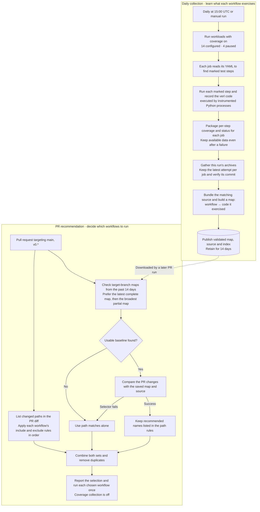

# How Ascend CI chooses workflows for a pull request

<!-- BEGIN workflow diagram -->



<details>
<summary>Which workflows participate?</summary>

| Reusable workflow | Daily collection call | PR path rules | PR workflow call |
| --- | --- | --- | --- |
| [e2e_ascend.yml](../../../.github/workflows/e2e_ascend.yml) | Configured | Yes | Yes |
| [e2e_ppo_trainer_megatron_sglang_2_ascend.yml](../../../.github/workflows/e2e_ppo_trainer_megatron_sglang_2_ascend.yml) | Paused | — | — |
| [e2e_ppo_trainer_megatron_sglang_ascend.yml](../../../.github/workflows/e2e_ppo_trainer_megatron_sglang_ascend.yml) | Paused | — | — |
| [e2e_ppo_trainer_megatron_vllm_2_ascend.yml](../../../.github/workflows/e2e_ppo_trainer_megatron_vllm_2_ascend.yml) | Configured | Yes | Yes |
| [e2e_ppo_trainer_megatron_vllm_ascend.yml](../../../.github/workflows/e2e_ppo_trainer_megatron_vllm_ascend.yml) | Configured | Yes | Yes |
| [e2e_ppo_trainer_veomni_vllm_ascend.yml](../../../.github/workflows/e2e_ppo_trainer_veomni_vllm_ascend.yml) | Configured | Yes | Yes |
| [e2e_sft_llm_ascend.yml](../../../.github/workflows/e2e_sft_llm_ascend.yml) | Configured | Yes | Yes |
| [e2e_v1_separate_async_ascend.yml](../../../.github/workflows/e2e_v1_separate_async_ascend.yml) | Configured | Yes | Yes |
| [model_ascend.yml](../../../.github/workflows/model_ascend.yml) | Configured | Yes | Yes |
| [npu_unit_tests.yml](../../../.github/workflows/npu_unit_tests.yml) | Configured | Yes | Yes |
| [reward_model_sglang_ascend.yml](../../../.github/workflows/reward_model_sglang_ascend.yml) | Paused | — | — |
| [reward_model_vllm_ascend.yml](../../../.github/workflows/reward_model_vllm_ascend.yml) | Configured | Yes | Yes |
| [sgl_ascend.yml](../../../.github/workflows/sgl_ascend.yml) | Paused | — | — |
| [vllm_ascend.yml](../../../.github/workflows/vllm_ascend.yml) | Configured | Yes | Yes |

</details>

<!-- END workflow diagram -->

## How selection works

The daily run answers “Which parts of verl did each workflow exercise?” The PR run asks “Which workflows exercised code this PR changes, and which workflows do our path rules require?” The unit of selection is a whole GitHub Actions workflow. A selected workflow runs its usual jobs and tests.

The daily collector calls the original Ascend workflows with `coverage_mode: true`. Each reusable workflow owns its jobs, environments, and commands, so editing a workload updates both daily collection and normal PR runs. The collector uses the verl adapter in `lb-actions/precision-test` to build the map once per collection and publishes it as `ascend-precision-map-<run-attempt>`.

**What crosses from one run to the next?** The baseline artifact contains the workflow-to-code map (`test_case_map.json`), the corresponding committed source tree (`covstub/verl/`), and an index recording the commit and available jobs. Before publishing, the collector validates the map and source snapshot and records `baseline_quality` in the map artifact's index. A complete baseline has mapped files for every enabled collection workflow and a complete archive for every expected job in those workflow definitions. The index lists missing map entries, missing archives and incomplete jobs. Explicitly paused jobs are excluded. A partial map can still be published if it covers an enabled workflow. [Collection workflow](../../../.github/workflows/coverage-collection-npu.yml)

**Which baseline does a PR use?** On the target branch, the PR considers completed scheduled and manual collection runs created in the last 14 days, newest first. Within a run it tries the latest attempt first. Each candidate is downloaded separately, checked against the run and source SHA, and assessed against the current collection plan. Download or validation failures skip that candidate. The first complete baseline wins. If every usable baseline is partial, the PR uses the one with mapped files for the most enabled workflows, preferring the newer candidate on a tie. Older indexes can be assessed from their job records. With no usable baseline the router uses path matches alone. [Baseline selection](baseline.py)

**Why keep both routes?** A failed job, skipped step, or worker that did not report coverage can leave a gap in the map. For example, a change to `requirements-npu.txt` can trigger a workflow through its path rules even when the selector recommends nothing. Path routing runs in a separate job after the optional coverage recommendation finishes or times out. The router keeps both sets, removes duplicates, and writes **Recommended**, **Selected by path**, and **Running** to the routing job summary. If both sets are empty, all downstream workflow calls are skipped. Each selected call uses the default `coverage_mode: false`. To enable another PR workflow, add its path rules and reusable workflow call. [PR workflow](../../../.github/workflows/precision-test-npu.yml) · [Router](route_pr.py) · [Ordered path rules](pr_paths.json)

To compare selectors across PRs, search the **Select runnable Ascend workflows** step log for `ascend_workflow_selection=` and parse the JSON after the prefix. Each record includes the base and head SHAs, baseline run, and selector outcome. `precision_test` lists all exported recommendations, including names outside the PR routing rules. An empty list means the selector exported zero names. A `null` means no recommendation list was available. `path_filters` lists the legacy path matches, and `running` lists the workflows the router selected.

## Scope and maintenance

Each reusable workflow declares its filename once in `VERL_COVERAGE_WORKFLOW`. Each job runs `bash scripts/ci/coverage/init.sh` after dependency installation. The collector derives the data directory from that filename and the GitHub run, attempt and job IDs. Packaging runs with `always()` and emits the archive path as a step output. The upload step uses that output even when packaging reports incomplete coverage. Avoid local composite actions here: the Kubernetes runner may not see files checked out inside the job container when it resolves a local action manifest. Direct commands execute in that container, where the repository is available. Coverage-mode concurrency groups are unique to each reusable workflow and separate from normal PR runs and the caller; timeouts are larger in coverage mode. Original job dependencies, conditions and step ordering are preserved.

Workload steps use a shared shell wrapper

```yaml
shell: python scripts/ci/coverage/collect.py run step-06 {0}
```

Each reusable workflow sets `VERL_COVERAGE_ENABLED` from `inputs.coverage_mode`. In normal mode the wrapper immediately executes `sh -e` without importing coverage or PyYAML or stopping Ray. Expressions are kept out of the step-level `shell` field.

When adding a workload step, use this shell with a unique step ID in that job. The command itself stays in the step's single `run` block. Data preparation, setup and cleanup steps must not use the coverage shell. Existing commands, environments and parameters can be edited normally without changing the collector. A new job needs the optional setup/package/upload steps and coverage shells; a completely new workflow also needs one `uses` entry in the caller.

At setup time, [collect.py](collect.py) reads the current job's coverage-marked steps directly from its workflow YAML to construct the manifest. Names, entrypoints and expected steps are not maintained in a separate JSON inventory. Missing or duplicate step IDs fail initialization.

## Collection behavior

Setup installs coverage.py 7.8.2 and PyYAML 6.0.2 into the ambient Python interpreter with uv. A dedicated opt-in [.pth startup hook](startup.py) preserves the image's existing `sitecustomize` and `PYTHONPATH`. If a workload introduces another Python environment, coverage and the hook must be installed there too.

Each coverage-marked Actions `run` block is one collection entry. Multiple commands in a block share coverage, preserving heredocs, shell state, checkpoint/resume ordering and validation commands. Different steps invoking the same script remain separate entries.

The wrapper sets coverage identity before executing the entire block, including any `ray start` command. It stops the container-local Ray cluster gracefully before and after a block so subsequent steps do not reuse workers with stale coverage identity. Original commands and their exit status are preserved; cleanup failures also fail the collection step. Coverage uses branch data, parallel process files, multiprocessing support and SIGTERM handling. It does not instrument data preparation, installation or packaging commands. Data preparation runs with the normal container shell and is excluded from the coverage manifest and artifacts.

Original failure and dependency behavior is retained. Following a failure, later dependent work may be skipped; its manifest entries remain explicitly incomplete. Packaging and artifact retention run with `always()`. Hard cancellation or runner loss can still prevent archiving.

## Artifacts

Each executed job retains a GitHub Actions artifact for 14 days, named `ascend-coverage-<workflow.yml>-<job-id>-<run-attempt>`. The tar contains

```text
manifest.json
packages.txt
source-workflow.yml
coveragerc
coverage/step-NN/coverage.<host>.<pid>.<suffix>
```

The source SHA, run/attempt, original workflow/job, step identities, aggregate process counts and per-step status allow later adapters to associate data correctly. Process startup JSON files are used for validation but excluded from the tar. Per-step `command.sh` copies are not created or included in archives; step names and entrypoints remain in the manifest. Aggregation also excludes `command.sh` files from older job artifacts. Valid coverage databases with no executed lines or arcs are also excluded; `empty_coverage_files_removed` records their count per step. The retained SQLite files are unchanged; no coverage combine operation consumes them. Corrupt databases remain available for diagnosis and still fail completeness. Removing preprocessing instrumentation does not eliminate empty databases from training subprocesses, so this filtering also runs during packaging. Different workflows, jobs and run attempts have separate workspace directories.

`collection_complete` requires all planned steps to pass, valid branch data for test/training steps, and data files for the observed interpreter startups. Missing data, hook errors, unrun steps and corrupt files cause finalization to fail, but the partial tar is still uploaded. `worker_coverage_verified` and `selection_ready` remain false: process counts cannot prove every Ray actor or engine subprocess was instrumented. Forked processes do not necessarily produce a separate startup record.

## Combined archive

The final `aggregate_coverage` job waits for every workload workflow, including failed or skipped calls, and downloads available job artifacts. It publishes `ascend-coverage-combined-<run-attempt>` containing one `coverage.tar.gz` with this layout

```text
index.json
workflows/<workflow.yml>/<job-id>/manifest.json
workflows/<workflow.yml>/<job-id>/coverage/step-NN/coverage.<host>.<pid>.<suffix>
covstub/verl/...
```

The combined archive keeps one shared source snapshot at `covstub/verl/`, beside `workflows/`. The top-level `covstub` field in `index.json` points to it. Aggregation creates this snapshot once using `git archive` from the run's exact source SHA in its checkout. Each selected job's manifest must match that SHA. Individual job artifacts do not include source snapshots; redundant snapshots from older attempts are ignored. The snapshot contains committed source, not any uncommitted changes made by workloads. All retained job files live under their workflow/job directory. `index.json` maps every called workflow filename to its caller result and available jobs, then each job to its manifest and step directories. Failed or skipped workflows with no artifacts remain in the index with `artifacts_present: false`. Partial job manifests retain their original completeness status; successfully bundling them does not certify coverage.

On a partial rerun, the latest available artifact for each job is used, including previous attempts of this same run when a job was not rerun. Each selected attempt is recorded. Run IDs and source SHAs must match; duplicate artifacts for the same workflow/job/attempt are rejected. No available archives is an error. The individual artifacts and combined artifact are retained for 14 days. When adding a caller workflow, also add it to the aggregate job's `needs` list.
